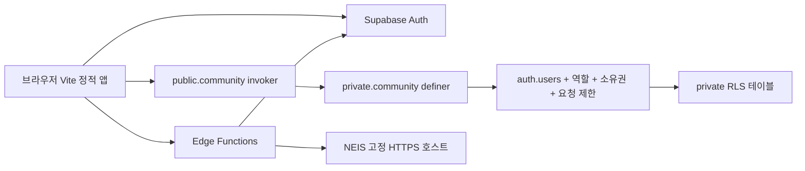

# 아키텍처

정적 프론트엔드를 Cloudflare Pages 또는 Vercel에 배포한다. 화면은 순수 DOM으로 생성하고 hash router로 전환한다. 화면, 공통 UI, 데이터 접근, 입력 검증을 분리해 향후 프레임워크 교체 시 API를 유지할 수 있다.

권한의 신뢰 경계는 클라이언트가 아니라 PostgreSQL과 Edge Function이다. public 스키마는 community RPC 래퍼만 제공한다. 래퍼는 security invoker이며 private 디스패처에만 제한적으로 EXECUTE를 위임한다. 디스패처의 security definer는 익명성 보호를 위한 명시적인 보안 경계다. RLS를 우회하는 만큼 모든 작업의 인증, 계정 존재, 현재 로그인 세션, 이메일 인증, 이용 제한, 소유권, 관리자 역할을 개별 검증한다. 테이블 직접 접근 권한은 없으며 RLS 정책도 기본 거부다.

권한 값은 private.user_roles에서 읽는다. user_metadata, 요청의 ID, role 또는 is_admin으로 권한을 부여하지 않는다. 프로필 생성에는 현재 auth.uid만 사용한다. 재학생 인증은 운영하지 않는다.

게시글 API는 private.post_json에서 필요한 필드만 반환한다. 댓글도 화이트리스트 JSON을 반환한다. 작성자 UUID·이메일은 일반 사용자에게 제공하지 않는다. 익명 번호는 글별 행 잠금과 매핑으로 생성해 다른 글의 번호와 연결할 수 없게 한다. 관리자 신고 조회만 신고 대상 계정 ID를 반환하며 이 조회를 감사 기록에 남긴다.

NEIS는 클라이언트가 API 키를 가지지 않도록 Edge Function이 호출한다. 사용자 토큰을 getUser로 검증하고, DB에서 이용 제한/요청 제한을 검사한다. Origin 허용 목록을 적용하며 고정된 NEIS 호스트만 요청한다. 인스턴스 내 최대 100키·1시간 캐시로 중복 요청을 줄인다. 캐시가 인스턴스 간 공유되지는 않는다.

계정 탈퇴는 현재 비밀번호로 재인증한 후 세션을 전역 로그아웃하고 Auth 사용자를 삭제한다. FK가 프로필·역할·좋아요·투표·알림을 삭제하고 게시글/댓글 작성자 연결을 NULL로 만든다. 기존 JWT가 남아 있어도 모든 RPC가 auth.users 존재를 다시 확인하므로 접근이 차단된다.

확장 시 원칙: 검색 규모가 커지면 pg_trgm 인덱스와 쿼리 계획 검증을 추가한다. 대량 공지 알림은 큐/배치로 전환하고, NEIS 캐시를 DB/공유 캐시로 옮길 수 있다. 무료 플랜을 고려해 Realtime 구독·이미지 업로드·장시간 서버 프로세스는 사용하지 않는다.
